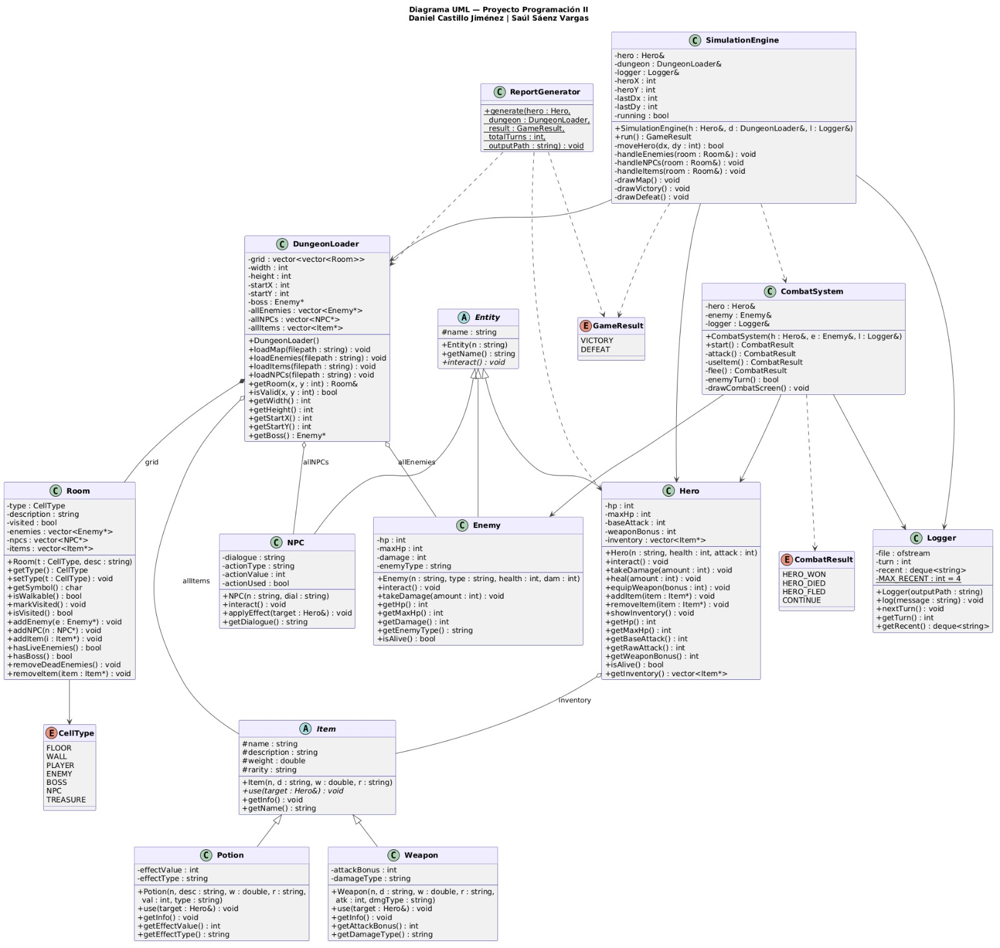

# ⚔️ Adventures & Dungeons — Console Simulation Engine

> **Course:** EIF204 Programming II · Universidad Nacional de Costa Rica (UNA) · I Cycle 2026
> **Team:** Daniel Castillo Jiménez & [Saúl Sáenz Vargas](https://github.com/SaulSaenz483)
> **Stack:** C++20 · CMake · STL · CLion

A turn-based dungeon crawler that runs in the terminal. The world (map, enemies, items and NPCs) is loaded from plain-text files, the hero explores an ASCII map, fights enemies, talks to NPCs, picks up gear and must defeat the final boss. Every event is written to a log, and a final report is generated when the game ends.

It is not meant to be a graphical game. The goal was to apply object-oriented design to a real domain, with a **clean layered architecture**, **polymorphism**, **explicit memory ownership** and **file I/O**.

```
+====================+==========================+
| Dungeon            | Tester                   |
+--------------------+--------------------------+
|                    | HP [||||||||||] 100/100  |
|####################| ATK 18                   |
|#...........#....B.#| --- Inventory ---        |
|#@##..####..#......#|                          |
|#..#.......##.E$...#|                          |
|#..#..E....#.......#| --- Legend ---           |
|#..N###....#..E....#| @ Hero  E Enemy          |
|#$..............N..#| B Boss  N NPC            |
|####################| $ Item  # Wall           |
+-----------------------------------------------+
| [T1] Adventure started. Hero: Tester          |
| [T1] Moved to (1,2)                           |
+-----------------------------------------------+
| WASD move   I inventory   Q quit              |
+===============================================+
```

---

## Features

- **Data-driven world:** the map, enemies, items and NPCs are loaded from `data/*.txt` with validation and clear error messages.
- **Turn-based combat:** attack, drink a potion or flee. The enemy always counter-attacks, and HP bars are drawn in ASCII.
- **NPCs with real effects:** they heal the hero or give a potion, and each one helps only once.
- **Items:** weapons are equipped automatically when picked up, and potions are used during combat.
- **Win/lose conditions:** defeat the boss to win, or lose when the hero's HP reaches 0.
- **Persistence:** `adventure_log.txt` records every turn, and `final_report.txt` summarizes HP, inventory, explored cells and the result.

## Architecture

The code is split into three layers with clear responsibilities:

| Layer | Folder | Responsibility |
|---|---|---|
| **Domain** | `include/domain`, `src/domain` | World entities: `Entity`, `Hero`, `Enemy`, `NPC`, `Item`, `Weapon`, `Potion`, `Room`, `DungeonLoader` |
| **Simulation** | `include/simulation`, `src/simulation` | Game loop (`SimulationEngine`) and combat (`CombatSystem`) |
| **Output** | `include/output`, `src/output` | Event log (`Logger`) and final report (`ReportGenerator`) |



### Key design decisions

- **Abstract base classes with pure virtual methods.** `Entity::interact()` and `Item::use(Hero&)` let the engine treat entities and items polymorphically. Inheritance is used only for real *is-a* relationships.
- **`dynamic_cast` used on purpose.** When an item is picked up, the engine checks whether it is a `Weapon` and equips it. Equipping is the engine's job, not the item's.
- **Explicit memory ownership.** `DungeonLoader` owns every `Enemy`, `NPC` and `Item` it creates. A `Room` only stores non-owning pointers. When the hero picks up an item, ownership is **transferred** to the `Hero`.
- **Non-copyable resource holders.** `Logger` and `DungeonLoader` delete their copy constructor and copy assignment (`= delete`), so a file handle or owned pointer can never be duplicated by accident.
- **`std::deque` in the logger.** It keeps the last 4 events for the on-screen panel and drops old ones in O(1).
- **Strongly typed `enum class`es** (`CellType`, `CombatResult`, `GameResult`) represent game states.
- **Robust parsing.** `getline` + `stringstream` with a `trim()` helper handles both Windows (CRLF) and Linux (LF) files.

## Build & run

Requirements: a C++20 compiler (GCC, Clang or MSVC) and CMake ≥ 3.16.

```bash
cmake -S . -B build
cmake --build build
cd build && ./adventures_and_dungeons      # Windows: adventures_and_dungeons.exe
```

> Run it from a real terminal (CMD, PowerShell, bash). CLion's run window does not support clearing the screen, so the map scrolls instead of redrawing.

### Controls

| Key | Action | | Combat key | Action |
|---|---|---|---|---|
| `W A S D` | Move | | `1` | Attack |
| `I` | Inventory | | `2` | Use potion |
| `Q` | Quit | | `3` | Flee |

### Input file formats

| File | Format |
|---|---|
| `map.txt` | `WIDTH\|HEIGHT`, then rows using `#` (wall), `.` (floor), `@` (start) |
| `enemies.txt` | `col\|row\|name\|type\|hp\|damage` (exactly one enemy of type `Boss`) |
| `items.txt` | `type\|col\|row\|name\|description\|weight\|rarity\|stat\|effect` (`W` = weapon, `P` = potion) |
| `npcs.txt` | `col\|row\|name\|dialogue\|action\|value` (`heal`, `give_potion` or `none`) |

## What this project taught me

- **Designing before coding.** We drew the UML first and split the code into layers. Because of that, adding the combat system or the report never meant touching the loader. This was the first time I felt the value of *separation of concerns*.
- **Polymorphism that actually earns its place.** Using `interact()` and `use()` through base-class pointers showed me when inheritance helps and when it is just code reuse in disguise.
- **Memory ownership is a design decision, not an afterthought.** Writing down "who deletes what" in the technical document made the rules clear. Finding a bug that broke those rules (see below) taught me even more.
- **Working as a team with Git:** dividing modules, merging each other's work and keeping a shared code style.
- **Defensive file parsing:** validating every field and giving useful error messages instead of crashing.

## Fixes after the course

After the project was graded, I reviewed it again with **AddressSanitizer** and fixed these issues:

| Issue | Cause | Fix |
|---|---|---|
| Crash (segfault) on exit after picking up an item | The item stayed in `DungeonLoader::allItems` *and* in the hero's inventory, so it was deleted twice | Added `DungeonLoader::releaseItem()` so ownership really moves to `Hero` on pickup |
| Quitting with `Q` reported **VICTORY** | `run()` returned `VICTORY` whenever the hero was alive | Added `GameResult::QUIT` |
| Did not run on Linux/macOS | Data files were named `Enemies.txt`/`NPCs.txt`, but the code loads `enemies.txt`/`npcs.txt` (Windows ignores letter case) | Renamed the files to match the code |

A full playthrough now runs clean under AddressSanitizer.

## Possible improvements

- Save and load the game state (serialization).
- Let the player compare weapons instead of auto-equipping them.
- Use `std::unique_ptr` for ownership instead of raw `new`/`delete`.
- Add unit tests for the loader and the combat rules.

---

📄 The full technical document (in Spanish) is in [`docs/technical-document-es.pdf`](docs/technical-document-es.pdf).
